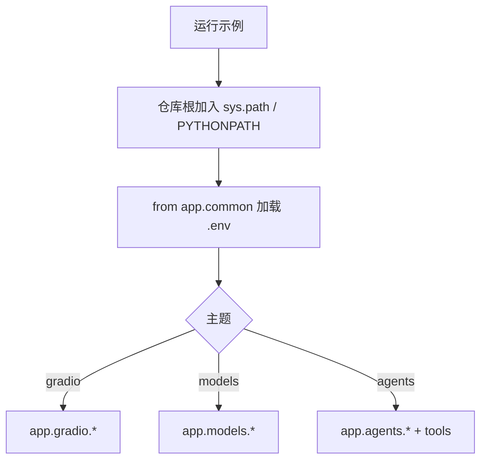

# AiDemo：示例收入 app/ 并去掉 `_code` 后缀

**目标服务：** `AiDemo`  
**日期：** 2026-11-04  
**类型：** Bounded  
**前置：** `2026-11-04-common-config-and-topic-dirs-design.md`  
**用户确认：** 采用 `app/` + `gradio` / `models` / `agents`（去掉 `_code`）；`docs` 留在仓库根

## 背景

主题目录与 `docs/` 同级显得混杂；`agent_code` 等命名带 `_code` 不自然。

## 目标 / 非目标

**目标**

- 将 `common`、`gradio_code`、`models_code`、`agent_code` 迁入 `app/`，并改名为 `common`、`gradio`、`models`、`agents`。
- 更新全部 import、`sys.path` 层级、`run.py`、`README`、`.env.example` 注释中的路径。
- `docs/`、`Video/`、根目录 `.env` / `run.py` 位置不变。

**非目标**

- 不迁 `docs` 进 `app`。
- 不改业务逻辑与环境变量语义。

## 决策

| 旧路径 | 新路径 |
| --- | --- |
| `common/` | `app/common/` |
| `gradio_code/` | `app/gradio/` |
| `models_code/` | `app/models/` |
| `agent_code/`（含 `tools/`） | `app/agents/`（含 `tools/`） |

- 导入：`from app.common...`、`from app.agents.tools...`
- 脚本内 `parents[1]` 改为 `parents[2]`（文件在 `app/<topic>/` 下，仓库根上溯两级）
- `run.py` 扫描 `app/gradio`、`app/models`、`app/agents` 顶层 `.py`

## 流程图

## 实现清单

- [x] 物理迁移并改名到 `app/`
- [x] 修正 import / path / run.py / README / .env.example / aiDemo001.py
- [x] 删除旧顶层包目录
- [x] 冒烟：菜单列表 + `app.common` / `app.agents.tools` 可导入

## 不在本期

- `Video/` 整理；空主题目录预留
