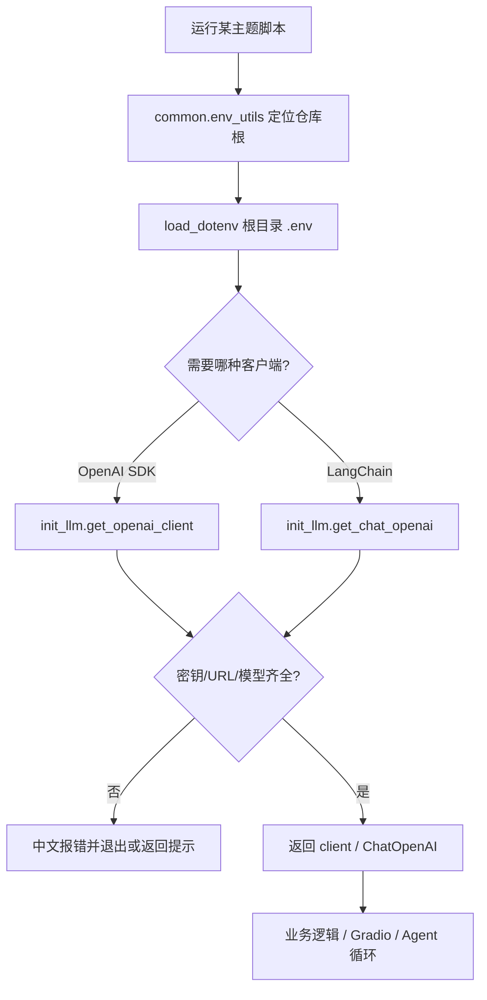
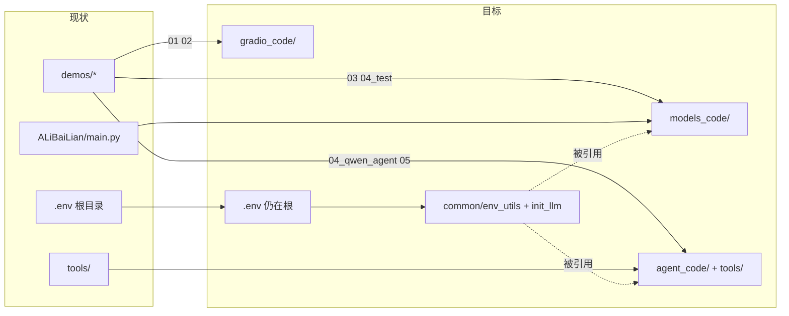

# AiDemo：统一 common 配置 + 按主题分目录

**目标服务：** `AiDemo`  
**日期：** 2026-11-04  
**类型：** Bounded（目录与公共层重构）  
**用户选择：** 方案 B；公共目录名 `common`  
**后续调整：** 目录已收入 `app/` 并去 `_code` 后缀，见 `2026-11-04-app-package-layout-design.md`

## 背景

参考学习项目（`PC_TMP`）按主题拆目录（`agent_code`、`models_code` 等），并把 `env_utils` / `init_llm` 一类配置抽到公共位置。当前 `AiDemo` 存在：

- 密钥读取方式不统一：`os.getenv("DASHSCOPE_*")`、根目录 `.env` + `ALI_BAILIAN_*`、以及 `DATA_*` 别名。
- 各 demo 各自 `load_dotenv` / 硬编码 `base_url`，缺少可复用的 LLM 初始化。
- 示例全部堆在 `demos/`，与「按 AI 能力主题学习」的组织方式不一致。

## 目标 / 非目标

**目标**

- 新增 `common/`：统一加载根目录 `.env`，导出环境变量常量与 LLM 工厂。
- 按主题迁出有内容的示例目录（本期只建有文件的目录，不建空壳）。
- 现有 AI 相关脚本改为使用 `common`，去掉散落的重复配置逻辑。
- 更新 `run.py` / `README.md`，菜单可扫描多主题目录。

**非目标**

- 不迁入 `Video/`（独立下载实验，保持原位）。
- 不新建空的 `deep_agent` / `guardrails_code` / `mcp_code` / `memory_code` / `rag_case`（后续有内容再加）。
- 不改密钥真实值；`.env` 仍 gitignore，仅维护 `.env.example`。
- 不引入新依赖（继续用现有 `python-dotenv` / `openai` / `langchain-openai`）。

## 决策

1. **公共目录名**：`common/`（非 `config/`）。
2. **`.env` 位置**：仍放**项目根**；`common/env_utils.py` 按仓库根路径 `load_dotenv`，保证从子目录启动也能找到。
3. **变量约定**（优先级从高到低）：
   - 通用 OpenAI 兼容：`DATA_*` → `ALI_BAILIAN_*`
   - DashScope 直连场景：`DASHSCOPE_API_KEY`；`base_url` 缺省为 DashScope 兼容端点
4. **`init_llm.py` 提供**：
   - `get_openai_client(...)` → `openai.OpenAI`
   - `get_chat_openai(...)` → `langchain_openai.ChatOpenAI`
   - 缺关键配置时给出明确中文错误，避免各 demo 各自打印
5. **主题目录映射（本期）**：

| 新目录 | 迁入内容 | 说明 |
| --- | --- | --- |
| `common/` | 新建 `env_utils.py`、`init_llm.py`、`__init__.py` | 配置与 LLM 工厂 |
| `models_code/` | `demos/03_qwen_chat.py`、`demos/04_test_langchain.py`、`ALiBaiLian/main.py` → 整理为编号脚本 | 模型调用入门 |
| `agent_code/` | `demos/04_qwen_agent.py`、`demos/05_weather_agent.py`；`tools/` 整目录迁入为 `agent_code/tools/` | Agent + Tool |
| `gradio_code/` | `demos/01_text_reverse.py`、`demos/02_image_to_sketch.py` | 非模型的 Gradio 基础 |
| （删除空壳） | 空的 `demos/06_hand_write.py`、空 `demos/`、空 `ALiBaiLian/` | 迁完后删除 |

6. **导入约定**：脚本内用仓库根加入 `sys.path`（或相对包导入），统一 `from common.env_utils import ...` / `from common.init_llm import ...`；`agent_code` 内工具改为 `from agent_code.tools import ...` 或相对导入，保证可从根目录 `python agent_code/05_weather_agent.py` 运行。
7. **`run.py`**：扫描 `gradio_code/`、`models_code/`、`agent_code/` 下顶层 `.py`（不含 `__*`、不含子包内工具文件），菜单显示为 `主题/文件名`。

## 流程图

### 主流程：启动 Demo 时的配置与 LLM 获取

### 目录重组迁移关系

## API / 数据影响

- **环境变量**：`.env.example` 补齐注释，明确 `ALI_BAILIAN_*`、`DATA_*`、`DASHSCOPE_API_KEY` 的用途与优先级；不强制改用户已有 `.env` 键名。
- **无 HTTP 服务契约变更**（本地学习脚本）。

## 实现清单

- [x] 新建 `common/__init__.py`、`common/env_utils.py`、`common/init_llm.py`
- [x] 更新根目录 `.env.example` 注释（变量优先级说明）
- [x] 创建 `gradio_code/`、`models_code/`、`agent_code/` 并迁移文件（含 `tools/` → `agent_code/tools/`）
- [x] 改造迁移后的 AI 脚本改用 `common`
- [x] 更新 `run.py` 多目录扫描与菜单展示
- [x] 更新 `README.md` 结构说明与运行示例
- [x] 删除空的 `demos/`、`ALiBaiLian/`（若已空）

## 不在本期

- RAG / MCP / Memory / Guardrails 主题目录
- `Video/` 整理
- 把 Gradio 基础课也接到 LLM
- CI / 自动化测试框架

## 验收

1. 根目录存在 `common/`，且 `.env` 仍在根、未被提交。
2. `python run.py` 能列出三个主题下的脚本并启动。
3. `models_code` / `agent_code` 中不再各自散落重复的 `load_dotenv` + 硬编码 URL（允许保留少量业务常量如默认模型名覆盖参数）。
4. 未配置密钥时错误提示清晰，指向 `.env.example`。
